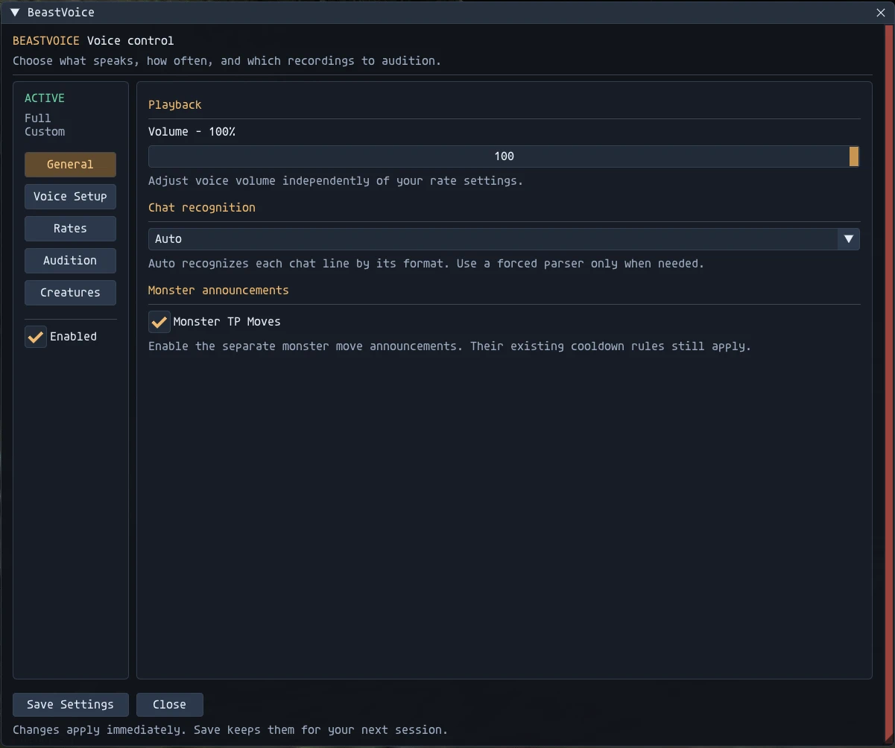
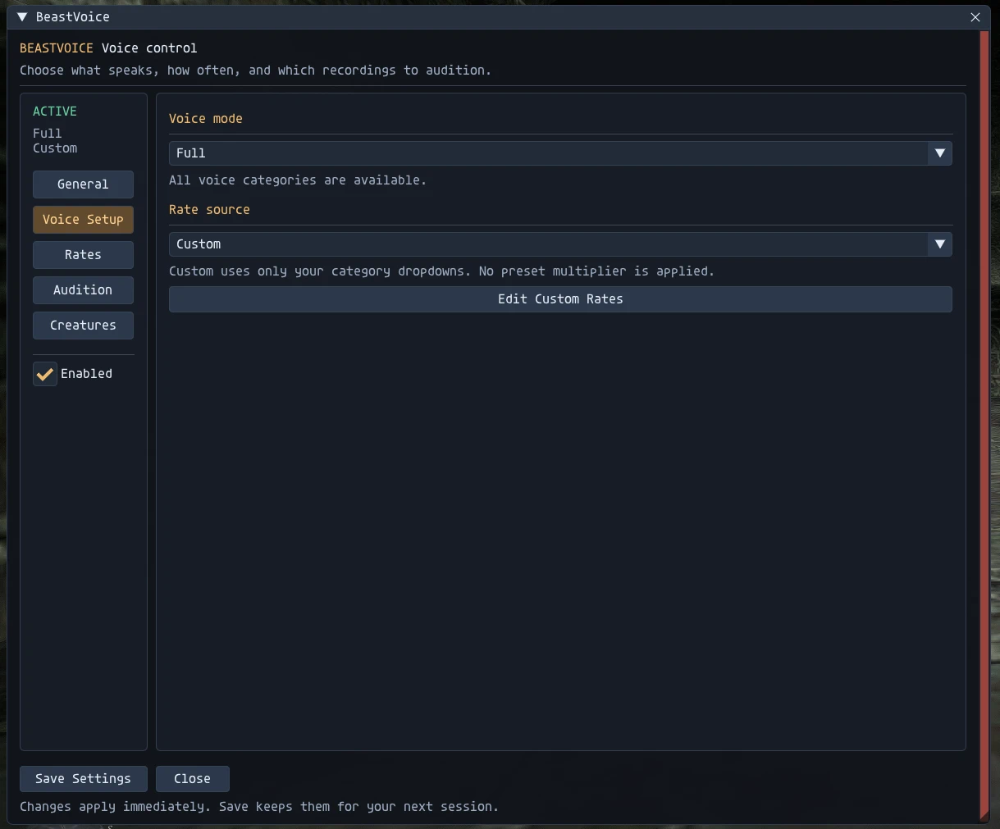
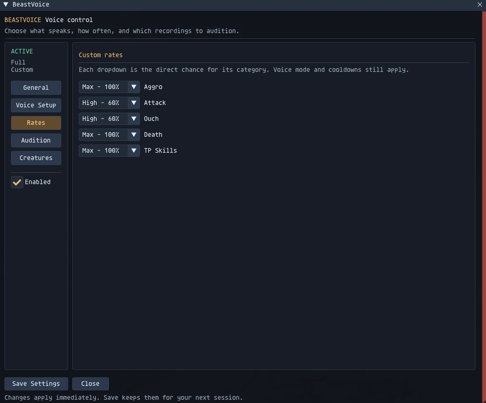
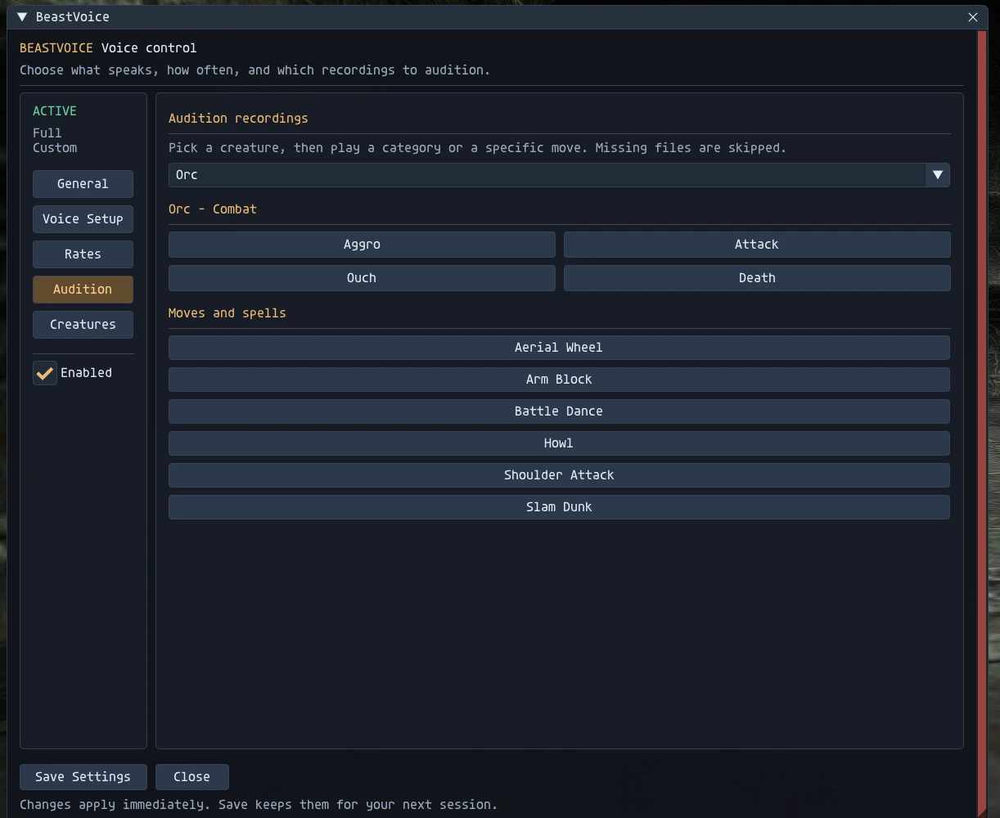

# BeastVoice 1.2

Creature combat voices for Ashita v4. Runtime version: 1.2.0.

## Download and install the addon

Download **BeastVoice-1.2.0-addon.zip** from [GitHub Releases](https://github.com/OpMoonRise2/BeastVoice/releases/latest). GitHub is the addon download and source-review location. This installation ZIP contains the Lua addon and documentation, without recordings or DAT overlays.

1. Unload the addon before updating. Preserve your existing settings and recordings.
2. Extract the ZIP into your Ashita folder. Confirm `addons/beastvoice/beastvoice.lua` exists. The ZIP already has an `addons/` folder.
3. Supply permitted recordings in `addons/beastvoice/sounds/`, or install the optional audio pack below. Matching recordings must be installed before voices can play.
4. Load `/addon load beastvoice`; open settings with `/bv`. After updating code, use `/addon reload beastvoice`.

No additional helper binary is shipped or required. BeastVoice uses Ashita's bundled Lua libraries and Windows' built-in `winmm.dll`; do not download replacement system DLLs. Use the named addon ZIP for direct installation. Automatic GitHub source archives use the repository layout and are intended for source review.

## Optional audio and native sound overlays

The [optional BeastVoice recordings on Nexus Mods](https://www.nexusmods.com/finalfantasy11/mods/32?tab=files) are separate from the addon. Download the addon itself from GitHub. Copy only the pack's `sounds/` content beside `beastvoice.lua`, or supply your own permitted audio using the recording names below. Missing recordings are skipped. Do not overwrite newer GitHub addon code with files from an older audio archive.

The optional Goblin bomb native sound overlay is a separate component outside this GitHub release. If using a permitted copy, place it at `polplugins/DATs/beastvoice-bombtoss/` and add `beastvoice-bombtoss` to your existing Pivot overlay list. Preserve other overlays. This repository grants no recording or DAT rights.

## Screenshots

Screenshots supplied by the author for this publication; recordings shown are installed separately.

## Controls

- Voice mode selects the categories that can play.
- Named voice presets use their own fixed rates. Custom uses the saved category rates.
- Creatures enables each supported family independently. Tonberry TP Songs controls Tonberry TP vocals separately from aggro, attack, ouch and death. Save Settings persists choices.
- Audition previews installed recordings. Reload with `/addon reload beastvoice` after updating code.

Ordinary TP vocals trigger on readies; completion lines are suppressed to prevent duplicates. Shadow Lord Implosion intentionally triggers on uses and plays its numbered recordings in order: 1, 2, 3, 4, then repeats from 1. Reloading the addon resets the sequence. Tonberry TP vocals use one exclusive BeastVoice channel; concurrent addon voice events are discarded until playback finishes. Bonze Marberry maps to Tonberry voices.

## How it works

BeastVoice only plays recordings. It does not change anything the server sees, and it does not play the game for you.

- **Combat lines.** It reads incoming chat-log lines (`text_in`) for messages the game already prints: a monster readying a TP move, casting, hitting, taking damage or being defeated. It plays a matching voice for that creature family. It never blocks or changes chat lines.
- **Aggro line.** A throttled scan of Ashita's entity table looks for monsters that are already engaged (status 1) and within 50 yalms. It counts only those targeting you or a party member, claimed by your party, or unclaimed and within 10 yalms. When it finds one, it plays that family's aggro voice once. A monster that hasn't engaged never triggers a voice. Distance is used only as a filter; nothing is drawn or displayed, and no positions, names or targets are shown.
- **Packets.** It reads incoming `0x00A`/`0x00B` (zone in/out) only to reset its state. It sends no packets, injects none and modifies none.
- **Audio and files.** Playback uses the Windows MCI player (`winmm.dll`). It writes its settings and `voice_duck_signal.txt` (so ZoneMusic can lower music under a voice), and reads recordings from `sounds/`.
- **Commands.** `/bv` and `/beastvoice` open the GUI and change settings; the handler blocks only the addon's own slash commands.

It queues no game commands, creates no macros and automates nothing.

## Shadow Lord encounter aggro

The opening aggro line is eligible only on the first engagement of the encounter. Phase-two re-engagement and mob-index changes do not replay it. The flag survives phase-one defeat and transient player-memory recovery; a fresh zone entry or player/zone identity change resets it. Existing aggro preset and rate settings still apply to the first opportunity. Audition remains independent.

## Shadow Lord Stonega

Stonega and tiered casts such as Stonega II use `Shadowlord/shadow_stonega.wav`. Supply that recording in the voice folder to enable it; a missing recording is skipped. This corrects the old Stonea spelling.

## Additional Shadow Lord spells

The following recordings have distinct mappings in `sounds/Shadowlord/`:

| Cast name | Recording |
| --- | --- |
| Burn | `shadow_burn.wav` |
| Rasp | `shadow_rasp.wav` |
| Choke | `shadow_choke.wav` |
| Frost | `shadow_frost.wav` |
| Freeze | `shadow_freeze.wav` |
| Shock | `shadow_shock.wav` |
| Drown | `shadow_drown.wav` |

Frost and Freeze are separate mappings. Use Frost for the elemental debuff recording; Freeze is supported separately if you record that spell too. Missing recordings are skipped. Add the WAVs before expecting their callouts to play.

## Recording names

Use the exact case and stems configured in `beastvoice.lua`. The resolver checks `.wav` before `.mp3`. Tonberry examples: `tonberry_ritual_bind.wav`, `tonberry_everyones_grudge.wav`, and `tonberry_everyones_rancor.wav`. Numbered category recordings must also be listed in the relevant category table; placing an extra numbered file in the folder does not automatically register it.

Audio and DAT payloads are distributed separately from the source bundle. Personal settings, runtime signals, backups and recordings marked unused are excluded.

## Normalized audio refresh (2026-10-19)

The complete Nexus package now contains 408 WAV recordings. Of these, 373 were attenuated for more consistent playback; 35 quieter recordings were preserved. Normalization targets active RMS of -20 dBFS and a sample-peak ceiling of -3 dBFS, without boosting quiet recordings. The largest reduction is 10.02 dB.

Four Shadow Lord recordings contained consecutive samples at the digital limit: attack 7, attack 9, ouch 3 and Thundaga. Their playback levels were reduced; pre-existing clipping distortion is not restored. The optional bomb overlay is unchanged.

`AUDIO-MANIFEST.json` records every packaged WAV hash, format, applied gain and measured sample peak. All WAV payloads were fully read and the normalized files verified against the installed addon. This refresh does not change runtime version 1.2.0. No new listening, live combat, LUFS or true-peak tests were performed.
